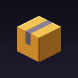

<div align="center">



# Repack

[](https://github.com/RATR2/repack/issues)
[](#install)
[](#install)
[](#install)
[](LICENSE)
[](#status)

> Custom blocks from Blockbench models, with no client mod and no entities on your server.
> A Paper plugin and its own resource pack.

If you find any issues, please report them [here](https://github.com/RATR2/repack/issues)

</div>

---

## What is this

Drop a `.bbmodel` file into the plugin folder and you have a custom block. Repack builds a resource pack from your models, places a hidden proxy block (a barrier by default) where the custom block goes, and shows the model on top of it. Players click, mine and collide with the proxy, so everything vanilla and every plugin already understands it.

- **No entities on the server.** The models are packet-based item displays, sent to each player only while they have the block's chunk loaded.
- **Saved with the world.** Placements live in the chunk's own data, so they survive restarts and travel with world copies and backups.
- **Its own pack.** Clients can hold several server resource packs at once, so Repack's pack sits next to your other packs and never has to be merged with them.
- **Saves rebuild the pack, quietly.** A few seconds after you save a model or block file Repack rebuilds the pack and tells nobody online. `/repack push` sends it to everyone online or to one player, and `/repack reload` builds and pushes it to everyone. Players who join get the newest build (or only the last pushed one, in the config). A pack that fails to build is never used.
- **Everything configurable.** Mining time, tool and tier, drops, experience, explosion and piston behaviour, model offset and scale, and the item that places the block.

Guides: [guide.md](guide.md) for running Repack, [dev.md](dev.md) for Skript and the Java API.

Every commit on `main` is built and published to [RATR2/repack-nightly](https://github.com/RATR2/repack-nightly).

## Install

Needs Paper 1.21.4 or newer (built with Java 25, but runs on Java 21 and up) and the [PacketEvents](https://github.com/retrooper/packetevents) plugin (the Spigot jar, 2.14.0 or newer). Clients from 1.21.4 to 26.3 are supported, older or newer ones than the server through [ViaVersion](https://github.com/ViaVersion/ViaVersion) (optional), and Repack sends each player the pack that fits their version.

1. Put `repack.jar` and `packetevents-spigot-2.14.0.jar` in `plugins/`.
2. Start the server. The first time, Repack adds a ready-made `table` block (`models/table.bbmodel` and `blocks/table.yml`). Set `install-defaults: false` before the first start to skip it.
3. Put your own models in `plugins/Repack/models/`. The file name is the block id: `chair.bbmodel` makes the block `chair`. Textures must be embedded in the model.
4. Save the files. The pack is built by itself, and players get it when they join. Use `/repack reload` or `/repack push` to send it to the ones online.
5. `/repack give table` and place it.

Repack writes `plugins/Repack/blocks/table.yml` for every model, with every option listed at its default. Edit it to change the block (the bundled `table.yml` shows a real one, with a crafting recipe, a glowing item and a scaled model), or copy it (`table2.yml`, same `model:`) for a second block that shares the model. `_example.yml` in the same folder explains each option and is rewritten on every start.

## Commands

| Command | What it does |
|---|---|
| `/repack build [force]` | Only rebuilds the pack from the models. Players keep the last published pack |
| `/repack push [players]` | Publishes the built pack and sends it to the players you name, or to everyone online |
| `/repack status` | Shows the built and published pack |
| `/repack place <id> [pos]` | Places a custom block (at your feet by default) |
| `/repack remove [pos]` | Removes a custom block |
| `/repack give <id> [amount] [players]` | Gives the item that places a block |
| `/repack builder [id]` | The block builder: edit a block in screens, with an exact item and recipe |
| `/repack menu` | Opens a screen with every block item; click to take one, shift-click for a stack |

Vanilla `/give @s repack:<id> [count]` works too, with tab completion. An item can show a different model than its block with `item.model` in the block file.
| `/repack list` | Lists the block ids |
| `/repack reload` | Reads the block files, rebuilds the pack and pushes it to everyone online. `blocks` only reads the block files, `config` and `host` only that part, `all` does everything |

All need the `repack.admin` permission.

## Skript

Works with Skript 2.13 and older through the old registration API and with 2.14 and newer through the new one. Repack picks the right one at startup.

```
on custom block interact of "table":
    cancel event
    send "You touched the table." to player

on right click:
    if event-block is a custom block with id "table":
        send "Same thing, with a normal click event." to player

on custom block explode of "table":
    uncancel event

command /table:
    trigger:
        give player custom block item "table" x 2
        place custom block "table" at player's location facing player's yaw
```

A fuller example with permissions, sounds and commands is in [examples/repack-example.sk](examples/repack-example.sk).

| Syntax | |
|---|---|
| `%blocks% is a custom block [with id %string%]` | Condition |
| `custom block id of %block%` | Expression, the id or nothing |
| `custom block item %string% [x %number%]` | Expression, the item that places a block |
| `all custom block ids` | Expression |
| `place custom block %string% at %locations% [facing %number%]` | Effect |
| `remove custom block at %locations%` | Effect |
| `register custom block %string% [using model %string%]`, `unregister custom block %string%`, `reload custom blocks` | Effects, until the next reload |
| `on custom block interact [of %strings%]` | Event, with event-block, event-player, event-string |
| `on custom block <action> [of %strings%]` | Event for everything that can happen to the proxy block |

The actions are `break start`, `break`, `explode`, `piston`, `burn`, `entity change`, `entity interact`, `fade`, `fluid`, `bucket`, `grow`, `physics` and `broken by block`. Each event starts out cancelled when the block resists that action (a piston on a block set to `piston: block`), so you can `uncancel event` to let it through.

## Java

```java
Class<?> api = Bukkit.getPluginManager().getPlugin("repack").getClass().getClassLoader()
    .loadClass("io.github.ratr2.repack.RepackAPI");
boolean placed = (boolean) api.getMethod("place", Location.class, String.class).invoke(null, location, "table");
```

`RepackAPI` also has `remove`, `idAt`, `isCustomBlock`, `item`, `register`, `unregister`, `reload` and `ids`. Listen for `CustomBlockInteractEvent` and `CustomBlockEvent` to react to clicks and to everything else that happens to a custom block.

## Protection plugins

Placing a block fires a normal `BlockPlaceEvent` and finishing a mine fires a normal `BlockBreakEvent`, so protection plugins judge them like any other block. With [WorldGuard](https://github.com/EngineHub/WorldGuard) installed, starting to mine also checks `block-break` and clicking checks `interact`, so a protected block shows no mining progress and does nothing.

## Status

In development. Built and unit tested, but not yet run on a live server, so expect rough edges.

- Models support cubes. Meshes and locators are skipped, and cube rotation is limited to what vanilla models allow (one axis, in steps of 22.5 degrees up to 45). Anything else is dropped with a warning when you build.
- Custom mining time relies on the server seeing the start of a dig on the proxy block. If your proxy block is unbreakable in survival and mining does not start, pick a breakable proxy block.

## Releasing

Every push builds and tests the plugin, and the jar is kept as a workflow artifact. A release is made by a commit on `main` whose message has tags on lines of their own (a word inside a sentence does nothing):

```
add the shelf display setting

tags:
version="0.1.0"
release
```

| Tag | |
|---|---|
| `version="0.1.0"` | The version. On its own it only sets `version` in `gradle.properties`. A suffix such as `0.2.0-beta.1` makes the release a pre-release. |
| `release` | Builds that version, tags the commit `0.1.0` and publishes a GitHub release with `repack-0.1.0.jar`. The release description is the commit message without the tags. |
| `next="0.2.0"` | What to continue with afterwards. Without it the next patch number is used. |

After a release the workflow commits `bump version to 0.1.1-SNAPSHOT [skip ci]` (or `0.2.0-SNAPSHOT` with `next`), which does not start another run. The tagged commit itself still says `-SNAPSHOT` in `gradle.properties`; the jar is built with the released version.

## License

See [LICENSE](LICENSE). MIT. The model parsing and pack generation are adapted from [BetterModel](https://github.com/toxicity188/BetterModel), also MIT, see [NOTICE](NOTICE).

---

<div align="center">

Thanks, R4T Out.

</div>
